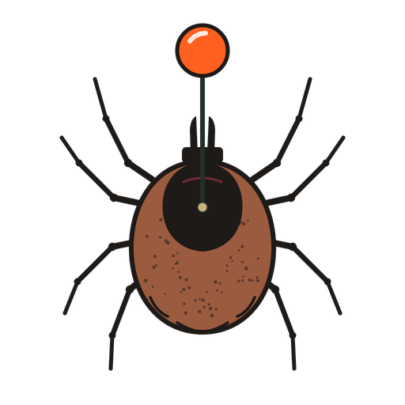
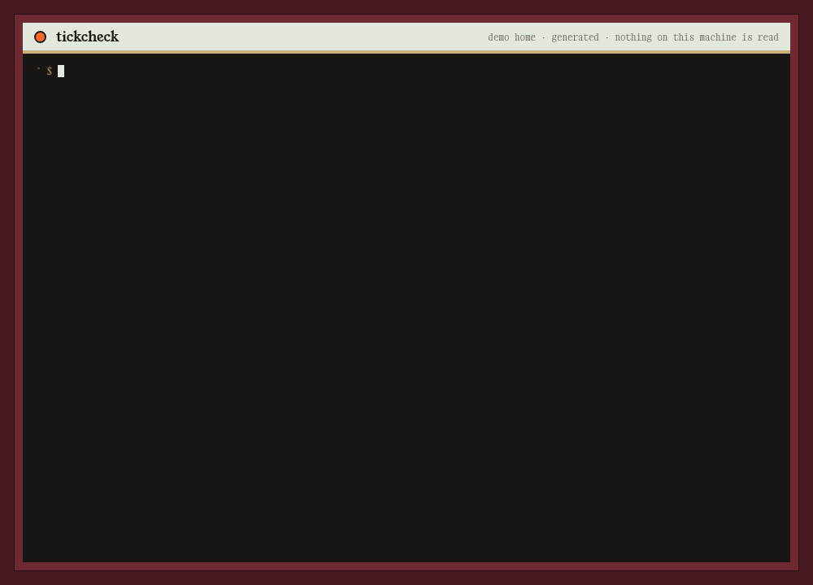

<p align="center"></p>

# tickcheck

**What runs every time Python starts? Checked without starting Python.**

LiteLLM 1.107.0 (PyPI and Docker, 2026-10-21) dropped a 12-byte `cook.pth` (`import cook`) and a `sitecustomize.py` into site-packages. Python runs both on **every** start in that environment, pip included. That makes the usual first check (`pip show`, `pip uninstall`, a Python scanner) run the stealer again. Every advisory says to dig through site-packages by hand. Each venv, conda env, pipx/uv tool and container has its own, and some `.pth` files are legitimate.

tickcheck is a single Go binary. It finds every Python environment on the machine, lists each startup hook in it, and tells you who installed it and whether it belongs. It never starts an interpreter.

## Install

```sh
curl -fsSL https://blackman99.github.io/tickcheck/install.sh | sh      # checks the release checksum
# or
go install github.com/Blackman99/tickcheck/cmd/tickcheck@latest
```

Binaries for Linux, macOS and Windows (amd64/arm64) are on the [releases page](https://github.com/Blackman99/tickcheck/releases).

## Use

```sh
tickcheck            # census of every env under ~ and the system installs; exit 4 = BAD, 3 = SUSPECT
tickcheck pull       # move BAD hooks into ~/.tickcheck/quarantine/ (restore any time), still without Python
```



Try it on a generated home first: `tickcheck --demo`.

Docs (verdict rules, IOC feed format, containers, CI, FAQ): **https://blackman99.github.io/tickcheck/docs/**

Blog: [What runs every time Python starts, and why pip is the wrong first check](docs/blog/python-startup-hooks.md) ([中文](docs/blog/python-startup-hooks.zh.md))
